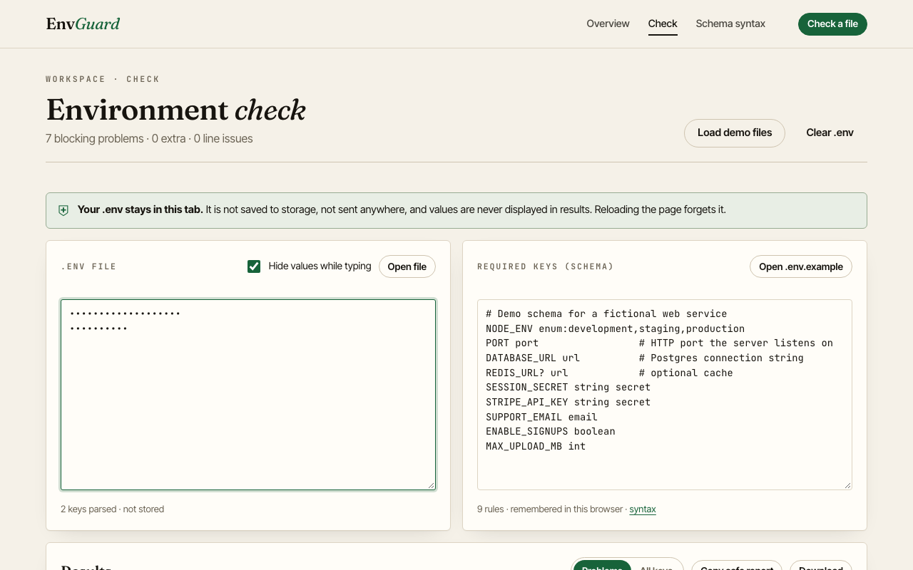
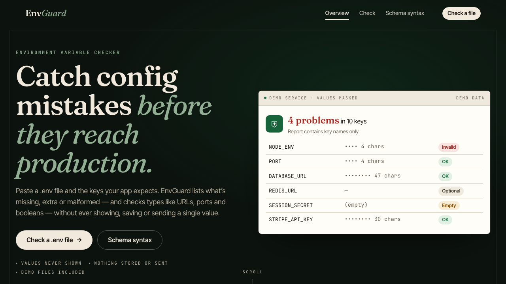
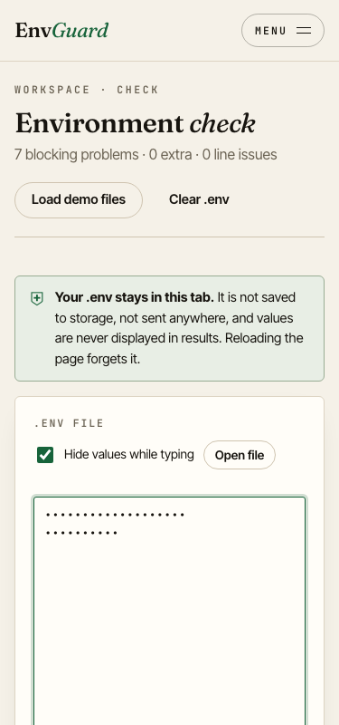

# EnvGuard

Check a `.env` file against the keys your app requires. EnvGuard reports missing, empty, invalid and extra keys plus line-level syntax problems — and never displays, stores or sends any value.



| Landing | Mobile |
| --- | --- |
|  |  |

## Run it

```bash
npm install
npm run dev        # http://localhost:5115
npm test
npm run build
npm run test:e2e   # Playwright smoke test (npm run e2e:install once if Chromium is missing)
```

## Main workflow

1. **Check** opens with a labelled demo `.env` and schema containing fictional placeholder values: a wrong enum value, an empty secret, a missing required key, an invalid email, an extra key, an invalid key name and a duplicate key.
2. Paste (or open) your `.env`. It is hidden while typing by default, held in memory only, and forgotten on reload.
3. Describe required keys in the schema box (`KEY type`, `KEY? type` for optional, `enum:a,b`, `secret`) — or paste a `.env.example`. Schema errors are listed with line numbers. Only the schema is remembered.
4. Read the results: counts, a table (problems only or all keys) with expected type, a masked value (“•••••••• 24 chars”) and the reason. Values in secret keys that look like real credentials (long, high-entropy, no placeholder words) get a warning.
5. **Copy safe report** / **Download** produce Markdown with key names and statuses only.

## Security notes

- The `.env` text is React state only — never written to localStorage, never sent over the network (there are no network calls at all).
- Results and reports never include values. Tests assert this.
- EnvGuard is a checker, not a secret store. For production secrets, prefer checking a sanitised copy.

## Tests

- `src/lib/env.test.ts` — .env parsing (export, quotes, inline comments, malformed lines, bad keys, unclosed quotes, duplicates), schema parsing (types, optional, enum, secret, .env.example, errors), type checks, findings, entropy heuristic, masking, report excludes values.
- `src/App.test.tsx` — demo results with values absent from the DOM, nothing stored in localStorage, schema errors, fully valid file, empty state.
- `e2e/smoke.spec.ts` — invalid → valid → invalid edits, values absent from the page and storage, reload forgets the `.env`; strict 375px checks.

## Limitations

- No variable expansion (`${OTHER}`), multi-line values or escape sequences inside double quotes.
- The real-secret heuristic is approximate and can miss secrets or flag random IDs.
- `-webkit-text-security` masking is not supported in every browser (Firefox shows text).

## Future improvements

- Variable expansion and multi-line values; compare several environments (dev / staging / prod) side by side.
